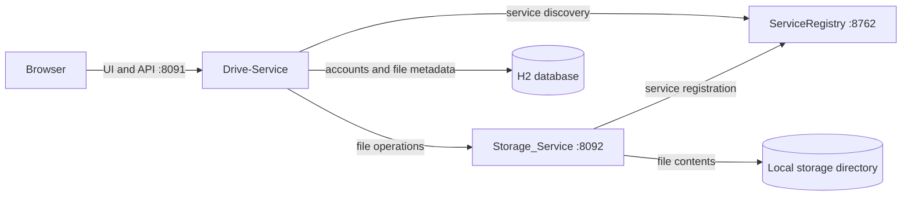

# Personal Drive

Personal Drive is a file storage app I built with Spring Boot. It has a browser interface for organizing files and folders, sharing items with other accounts, and managing file history and storage space.

The application uses a microservices architecture built with Spring Boot. Its three independently runnable services separate the Drive application and metadata, file-content storage, and service discovery. Drive-Service communicates with Storage_Service for file operations, while Drive-Service and Storage_Service register with ServiceRegistry through Eureka. The web interface is served by Drive-Service, so there is no separate frontend server to start.

## What it can do

- Create an account, sign in, and manage a session
- Create folders and move through a folder structure
- Upload, download, search, sort, and preview files
- Switch between list and grid layouts and browse paginated results
- Move items to Trash, restore them, or delete them permanently
- Share files and folders with viewer or editor access
- Keep file versions and restore an earlier version
- See storage usage and enforce a per-account quota

## Microservices architecture



| Service | Port | Role |
| --- | ---: | --- |
| ServiceRegistry | 8762 | Eureka service registry and dashboard |
| Storage_Service | 8092 | Stores and streams file contents |
| Drive-Service | 8091 | Web UI, accounts, metadata, permissions, sharing, versions, and quota |

## Run it locally

You’ll need Java 21. Start each service in its own terminal from the project folder, in this order.

**1. Start the service registry**

```bash
cd ServiceRegistry
./mvnw spring-boot:run
```

**2. Start file storage**

```bash
cd Storage_Service
./mvnw spring-boot:run
```

**3. Start the Drive app**

```bash
cd Drive-Service
./mvnw spring-boot:run
```

Then open [http://localhost:8091](http://localhost:8091), create an account, and sign in. The registry dashboard is available at [http://localhost:8762](http://localhost:8762).

Keep all three services running while you use the app. On a fresh local run, Drive-Service creates its H2 database under `Drive-Service/data`, and Storage_Service saves uploaded content under `Storage_Service/data/objects`.

## Run with Docker Compose

Install Docker Desktop, then from the project root create your local environment file:

```bash
cp .env.example .env
```

Edit `.env` and replace the example signing secret. Keep `.env` private; it is ignored by Git. Then build the service images and start the application:

```bash
docker compose up --build
```

Open [http://localhost:8091](http://localhost:8091). Compose keeps the H2 database and uploaded files in named volumes, so they survive container recreation. Stop the services with `Ctrl+C`, or run `docker compose down`. Avoid `docker compose down -v` if you want to keep the saved data.

To publish the built images to Docker Hub, sign in and push from the project root:

```bash
docker login
docker compose push
```

The published images are:

- `arjunsingh63/personal-drive:1.0`
- `arjunsingh63/drive-storage:1.0`
- `arjunsingh63/drive-registry:1.0`

### Run the published images

After the source repository is on GitHub, clone it to get the Compose file and environment template:

```bash
git clone https://github.com/aj234762-oss/Personal-Drive.git
cd Personal-Drive
cp .env.example .env
```

They should edit `.env` and set a private signing secret, then pull and start the published images:

```bash
docker compose pull
docker compose up -d --no-build
```

The app will be at [http://localhost:8091](http://localhost:8091). To stop the services while keeping saved data, run `docker compose down`. Compose uses the named volumes for the database and uploaded files.

The images can also be pulled individually, although running the complete app is easiest with the Compose file:

```bash
docker pull arjunsingh63/personal-drive:1.0
docker pull arjunsingh63/drive-storage:1.0
docker pull arjunsingh63/drive-registry:1.0
```

## Configuration

The default per-account quota is 5 GiB. Set `DRIVE_STORAGE_QUOTA_BYTES` to change it. For example, to use a 1 GiB quota when starting Drive-Service:

```bash
cd Drive-Service
DRIVE_STORAGE_QUOTA_BYTES=1073741824 ./mvnw spring-boot:run
```

`DRIVE_STORAGE_DIR` changes the local file storage directory. `DRIVE_STORAGE_JWT_SECRET` sets the shared credential Drive-Service uses when it calls Storage_Service. The default secret is only intended for local development; set your own value if you expose the services beyond your machine.

## Run the tests

Run the tests from each service’s directory:

```bash
./mvnw test
```

Drive-Service has focused tests for access permissions, sharing, quota limits, version history, and Trash behavior. Its Spring context test uses the configured H2 database. If the app is already running against the local database, stop it before running the full suite, or use a temporary in-memory database:

```bash
./mvnw test -Dspring.datasource.url='jdbc:h2:mem:drive_test;DB_CLOSE_DELAY=-1'
```

## Current scope

This setup is for local development. Drive-Service uses H2, and Storage_Service writes files to local disk. Backups, managed cloud storage and database services, resumable uploads, and activity history are not part of the project yet. Those would be the next steps before treating it as a production deployment.
